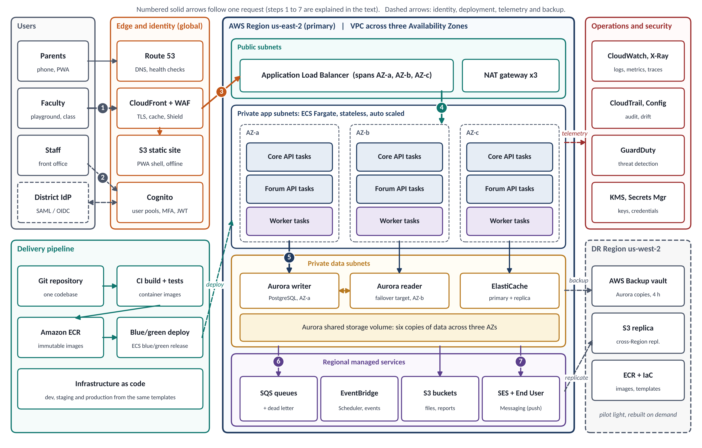

# Tales of a Fourth Grade: Cloud Architecture Design

A cloud-native architecture design for an elementary school student management system, delivered as software as a service on AWS.

This is a design exercise (an "architectural kata") completed for CS 7346 Cloud Computing at Southern Methodist University, Fall 2026. Nothing here was built or deployed. The repository holds the design report, the presentation, and the diagrams.

## The problem

The kata asks for one system that lets faculty, staff, and parents:

- Track absences, tardies, and excuses
- Track grades and assignments
- Generate reports on student activity
- Use parent-teacher forums
- Reach the system from the playground
- Run as SaaS from a hosting center

Students never sign in. Adults record and read information about young children, so privacy leads the design.

## The design in brief

| Area | Choice |
|---|---|
| Scale assumed | 250,000 students, 500 schools, about 50 districts |
| Peak load | 5,000 requests per second design ceiling |
| Availability target | 99.9 percent |
| Region layout | One primary Region across three Availability Zones, pilot-light recovery in a second Region |
| Front end | Offline-capable progressive web app on S3 and CloudFront |
| Identity | Amazon Cognito, with staff federated to district identity providers |
| Compute | Stateless containers on ECS Fargate |
| Data | Aurora PostgreSQL shared across districts, isolated with row-level security |
| Background work | SQS queues and worker tasks |
| Notifications | SES and AWS End User Messaging |
| Estimated cost | About $8,300 a month, roughly 40 cents per student per year |

## Key tradeoffs

- **One Region, not two.** A whole-Region outage means up to 8 hours of downtime and up to 4 hours of lost entries. A warm standby would add $5,000 to $7,000 a month, so the design accepts slower recovery.
- **One shared database, not one per district.** Sharing is more than 90 percent cheaper, and it means the row-level security policies have to be correct. Automated cross-district tests guard that.
- **Offline attendance.** Teachers can take attendance with no signal and sync later. Unsynced entries sit on the phone for a while, which is state outside a managed service.
- **Managed services wherever one exists.** The assumed team is eight engineers with no operations staff, so the design pays the managed-service premium and accepts dependence on one provider.

## What is in this repository

| Path | Contents |
|---|---|
| `report/` | The full design report (PDF): assumptions, use cases, quality attributes, Twelve-Factor and Well-Architected alignment, service choices, cost, and risks |
| `slides/` | The 12-slide presentation, with speaker notes |
| `diagrams/` | The architecture diagram, use cases, daily load profile, and monthly cost breakdown |

## Known limits and next steps

- The numbers are estimates from AWS list prices and need a real pilot to confirm.
- Next steps would be Aurora Global Database to shrink the data-loss window, then a warm standby, a dedicated database tier for large districts, and passkey sign-in.

## Author

David Storey
